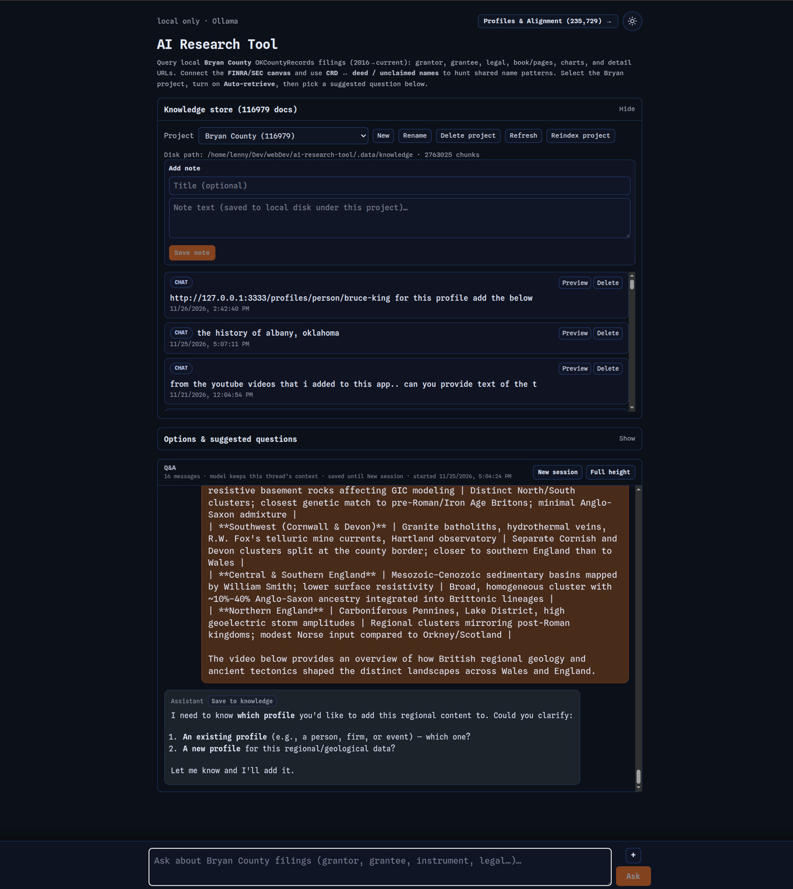
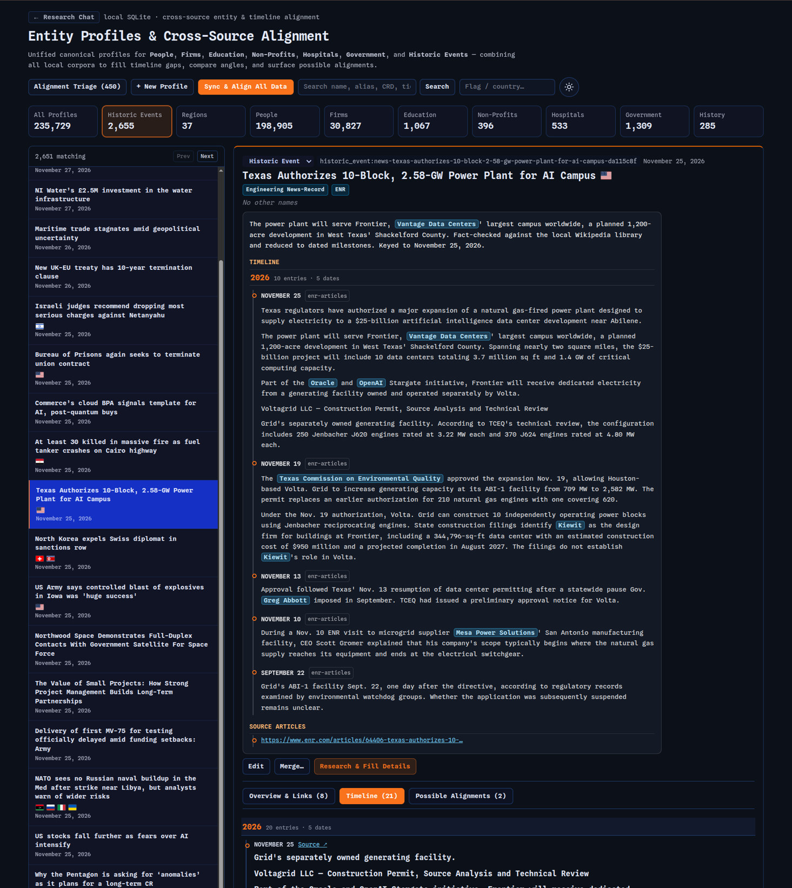
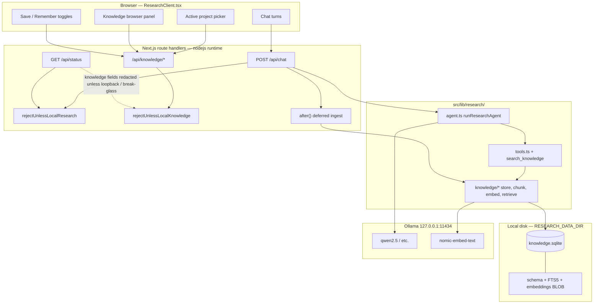
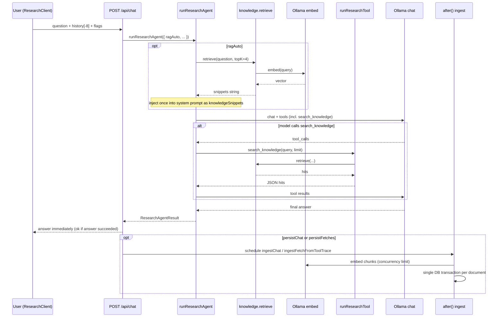

# AI Research Tool

Local research workspace (port **3333**) for turning news, filings, and web sources into structured **entity profiles**—people, firms, governments, nonprofits, historic events—with timelines, locations, identifiers, and linked relationships.

**Build profiles automatically** from news events and other material by:

- **AI Chat** — paste an article, RSS digest, press release, or filing excerpt and ask the model to create or update profiles (`search_profiles` / `upsert_profile`). The agent extracts names, dates, roles, addresses, and links them into the Profiles store.
- **Profiles dashboard** — browse and edit the same entities at `/profiles` (Overview, Timeline, Connections, Locations). Seed from imported news topics, land deeds, or bulk scripts, then refine in the UI.

Under the hood: Ollama chat, a local SQLite knowledge store (RAG), Profiles SQLite, and download/ingest pipelines for Oklahoma / Texas public records and related corpora (all under `.data/`).

### Profiles dashboard





---

## Prerequisites

| Requirement | Notes |
| --- | --- |
| **Node.js ≥ 22.13** | Uses built-in `node:sqlite` |
| **pnpm** | `packageManager` is `pnpm@11.3.0` |
| **[Ollama](https://ollama.com)** | Local chat + embeddings |
| **Docker** (optional) | FlareSolverr for OKCountyRecords / Cloudflare pages |
| **Python 3 + [uv](https://github.com/astral-sh/uv)** (optional) | Research Drive OCR, Digital Earth / PQW / META25 / Physics Congress crawlers |
| **Playwright** (optional) | Dallas deeds, some authority scrapers (`pnpm exec playwright install`) |

---

## Quick start (chat only)

```bash
pnpm install
ollama pull ornith:latest          # or another chat model in the picker
ollama pull nomic-embed-text       # optional; needed for knowledge embeddings / RAG
cp .env.example .env.local         # edit if needed
pnpm dev                           # http://localhost:3333
```

- **Chat** (`/`) — ask questions or paste news/filings and request profile upserts  
- **Profiles** (`/profiles`) — browse Overview + Timeline cards (screenshots above)

Smoke the knowledge store: `pnpm knowledge:smoke`.

---

## First-time setup checklist

1. Install Node deps: `pnpm install`
2. Start Ollama and pull at least one chat model (+ `nomic-embed-text` for RAG)
3. Copy `.env.example` → `.env.local` (defaults are fine for loopback-only use)
4. Start the app: `pnpm dev` (must be on **:3333** for most ingest scripts)
5. For Oklahoma land records / Yahoo enrich: start **FlareSolverr** (below)
6. Download only the corpora you need (tables below), then ingest while the app is running
7. In the UI: pick the matching knowledge **project**, turn on **Auto-retrieve** when asking about that corpus

### FlareSolverr (OKCR / Cloudflare)

```bash
docker run -d --name flaresolverr -p 8191:8191 --restart unless-stopped \
  --dns 8.8.8.8 --dns 1.1.1.1 \
  ghcr.io/flaresolverr/flaresolverr:latest
```

Health: `curl -fsS http://127.0.0.1:8191/health`. If DNS breaks (`ERR_NAME_NOT_RESOLVED`), recreate with the `--dns` flags above.

### Python venv (OCR + site corpora)

```bash
pnpm bryan:monitor:setup
# installs into .venv-monitors from scripts/requirements-bryan.txt
# later: uv pip install --python .venv-monitors/bin/python <pkg>
```

---

## External data: download & ingest

**Pattern:** most pipelines write files under `.data/<name>/`, then POST into the knowledge store via the running app on `:3333`. Agent tools (`search_*`) read those projects or `.data` folders.

Unless noted, run **download/crawl first**, then **ingest** with `pnpm dev` already up.

### Recommended starter set

| Goal | Commands | Knowledge project / path |
| --- | --- | --- |
| Bryan County deeds (live) | FlareSolverr + `BRYAN_MONITOR_ONCE=1 pnpm bryan:monitor` | **Bryan County** |
| OK / TX earthquakes | `pnpm seismic:download && pnpm seismic:ingest` | **OK TX Seismic** → `.data/seismic/` |
| OK / TX tornadoes | `pnpm tornado:download && pnpm tornado:ingest` | **OK TX Tornadoes** → `.data/tornadoes/` |
| Profiles seed (optional) | `pnpm profiles:backfill` | Profiles SQLite → `.data/profiles/` |

### Oklahoma County Records (OKCR)

Requires FlareSolverr + app on `:3333`. Results-table scrapes include grantor/grantee/legal/book (legal may show `N more…` until enriched from the detail page).

| Script | Purpose |
| --- | --- |
| `pnpm bryan:monitor` | Real-time Bryan poll (detail pages) |
| `pnpm bryan:backfill:2026` | Bryan 2026 YTD search pages |
| `pnpm bryan:backfill:2016-current` | Bryan historical range |
| `pnpm okcr:backfill:county` | Single county (`OKCR_SITE=…`, date range env) |
| `pnpm okcr:backfill:east-i35` | East-of-I-35 county orchestrator |
| `pnpm okcr:backfill:rest-ok` | Rest-of-OK orchestrator |
| `pnpm okcr:enrich-legals` | Expand truncated `N more…` legals from detail pages (`PROFILE_SLUG=firm:…`) |
| `pnpm profiles:associate-deeds` | Link OKCR instruments to firm/person profiles |

Checkpoints: `.data/monitors/{site}-backfill-*.json`, `bryan-seen.json`.  
Ingest API: `POST /api/monitors/bryan/ingest` with `{ filings: [...] , projectName? }`.  
Instrument codes: [`docs/okcr-instrument-glossary.md`](docs/okcr-instrument-glossary.md).

Useful env: `RESEARCH_APP_URL`, `FLARESOLVERR_URL`, `OKCR_SITES`, `OKCR_FROM_SITE`, `OKCR_FROM_YEAR`, `BRYAN_BACKFILL_START`, `BRYAN_BACKFILL_END`, `BRYAN_BACKFILL_MAX_PAGES`.

### Dallas County deeds (TX publicsearch)

```bash
pnpm dallas:download    # → .data/dallas-deeds/  (Playwright)
pnpm dallas:ingest      # → knowledge project "Dallas County Deeds"
```

### Seismic & tornadoes

```bash
pnpm seismic:download && pnpm seismic:ingest   # USGS ComCat M≥2.5 since 2016, OK+TX
pnpm tornado:download && pnpm tornado:ingest   # SPC tracks + NCEI narratives since 2016
```

### Authority timelines & entity dossiers

```bash
pnpm authority:download      # ICE / CBP / DHS / WH / etc. → .data/authority-timelines/
pnpm authority:dea           # DEA via Playwright when needed
pnpm authority:aggregate
pnpm authority:ingest        # knowledge project "Authority Initiatives"

pnpm entities:seed && pnpm entities:enrich && pnpm entities:link
pnpm entities:digest && pnpm entities:ingest   # "Entity Dossiers"
```

### Research Drive (local folder mirror)

Stage files under `.data/research-drive/` (manual sync; Drive folder is auth-walled).

```bash
pnpm research-drive:ocr          # digests → .data/research-drive/ocr/
pnpm research-drive:ocr:once     # smoke (--limit 5)
pnpm research-drive:ingest       # knowledge project "Research Drive"
pnpm research-drive:translate-thai
```

Serve a single file in-app: `GET /api/research-drive/file?path=…`.

### TWDB Trinity Aquifer

```bash
pnpm twdb:trinity                # download + organize + ingest
pnpm twdb:trinity:restructure    # layout only
pnpm twdb:trinity:ingest         # ingest only → searchable via search_twdb_trinity
```

### Site corpora (Python crawlers)

Use `.venv-monitors` (see setup above). Typical flags: `--crawl-only` / `--pages-only`, `--assets-only`, `--videos-only`, `--ingest-only`.

| Corpus | Commands | Data dir |
| --- | --- | --- |
| Digital Earth / ISDE | `pnpm digitalearth:crawl` … `pnpm digitalearth:all` / `:ingest` | `.data/digitalearth-isde/` |
| Petersburg Quantum Weeks | `pnpm pqw:pages` … `pnpm pqw:all` / `:ingest` | `.data/pqw-itmo/` |
| META 2025 | `pnpm meta25:crawl` … `pnpm meta25:all` / `:ingest` | `.data/meta25/` |
| Physics Congress 2026 | `pnpm physics-congress:pages` … `:all` / `:ingest` | `.data/physics-congress/` |
| Photonic quantum | `pnpm photonic-quantum:ingest` | (ingest helper) |
| IWM conflict timeline | `pnpm iwm:build` / `pnpm iwm:crawl` | `.data/iwm-conflict-timeline/` |
| Regional history | `pnpm regional:build` | `.data/regional-history/` |

### News RSS

```bash
pnpm news:rss                    # one pass
pnpm news:rss:loop               # long-running
pnpm news:rss:backfill-full
pnpm news:rss:consolidate
pnpm news:rss:format
pnpm news:rss:tx-ok-crime        # TX/OK crime feed catalog
pnpm tx-ok-crime:ingest
```

### YouTube / concealment scrubs & questions playlist

Scrub artifacts live under `.data/concealment-scrubs/`. MindUnveiled OCR: `pnpm mu:ocr` / `pnpm mu:ocr:once`.

```bash
pnpm questions:monitor:seed      # mark current playlist IDs seen
pnpm questions:monitor:once      # one daily check
pnpm questions:monitor           # 24h loop
```

### Offline Wikipedia (Kiwix)

```bash
# After a ZIM exists under .data/wikipedia/ (large download; see run_wikipedia_zim_download.sh)
pnpm wikipedia:serve             # kiwix-serve on :8765
```

Agent tool: `search_wikipedia`. Env: `KIWIX_SERVE_ORIGIN` / `RESEARCH_KIWIX_ORIGIN` (default `http://127.0.0.1:8765`).

### Chat history imports

```bash
pnpm grok-qa:import              # → knowledge "Grok Q&A"
pnpm gemini-qa:import            # → knowledge "Gemini Q&A"
```

### Profiles from news (chat or dashboard)

1. Ingest news into knowledge (`pnpm news:rss`, topic consolidate/format, or paste text in chat).
2. In **AI Chat**, select the news project (optional Auto-retrieve) and ask to create profiles for named people/orgs, or paste the article and say “upsert profiles with employment dates and HQ.”
3. Open **Profiles** to review Overview (aliases, identifiers, summary) and Timeline (career chapters, events). Edit links, locations, and timeline rows in the dashboard as needed.

### Profiles bulk imports

Many one-shot seeders exist as `pnpm profiles:import-*` (hospitals, oil companies, nonprofits, cabinets, dynasties, etc.). Enrichment:

```bash
pnpm profiles:backfill
pnpm profiles:enrich
pnpm profiles:align
pnpm profiles:associate-deeds
pnpm profiles:download-free-org-bulk
pnpm profiles:backfill-org-free-enrich
pnpm sec:ciks-since-2016
pnpm firm:id-filter
```

Land deeds on a profile overview: `GET/POST /api/profiles/{id|slug}/land-deeds`.

---

## HTTP API (built-in)

Base URL: `http://127.0.0.1:3333`. Knowledge and most write routes are **localhost-only** unless `ALLOW_LOCAL_AI=1` and (for knowledge) `RESEARCH_KNOWLEDGE_REMOTE=1`.

### Status & chat

| Method | Path | Purpose |
| --- | --- | --- |
| `GET` | `/api/status` | Ollama reachability, models, knowledge summary |
| `POST` | `/api/chat` | Research chat `{ question, model?, history?, projectId?, persistChat?, persistFetches?, ragAuto?, aboutNodeGraph?, canvasSnapshot? }` |
| `GET` `PUT` `DELETE` | `/api/chat/session` | Chat session persistence |

### Knowledge store

| Method | Path | Purpose |
| --- | --- | --- |
| `GET` `POST` | `/api/knowledge/projects` | List / create projects |
| `PATCH` `DELETE` | `/api/knowledge/projects/[id]` | Rename / delete |
| `GET` `POST` | `/api/knowledge` | List docs (`?projectId=`) / create note |
| `GET` `DELETE` | `/api/knowledge/[id]` | Get / delete document |
| `POST` | `/api/knowledge/search` | `{ projectId, query, limit?, sourceType? }` |
| `POST` | `/api/knowledge/chat` | Persist Q&A turn |
| `POST` | `/api/knowledge/fetches` | Persist fetch_url bodies from toolTrace |
| `POST` | `/api/knowledge/attachments` | Attach files into knowledge |
| `POST` | `/api/knowledge/reindex` | Re-embed `{ projectId? }` |

Wipe store: delete the folder from `GET /api/status` → `knowledge.path` (default `.data/knowledge/`).

### Monitors & charts

| Method | Path | Purpose |
| --- | --- | --- |
| `POST` | `/api/monitors/bryan/ingest` | Batch-ingest OKCR filings into a knowledge project |
| `POST` | `/api/charts` | Create chart artifact |
| `GET` | `/api/charts/[id]` | Serve chart image (PNG default) |

### Profiles

| Method | Path | Purpose |
| --- | --- | --- |
| `GET` `POST` | `/api/profiles` | Search / create profiles (`?q=`) |
| `GET` `PATCH` `DELETE` | `/api/profiles/[id]` | Detail by id or slug (e.g. `firm:bok-financial-corporation`) |
| `GET` `POST` | `/api/profiles/[id]/timeline` | Timeline entries |
| `POST` | `/api/profiles/[id]/employment` | Employment spans |
| `GET` | `/api/profiles/[id]/disclosures` | FINRA disclosure panel data |
| `POST` | `/api/profiles/[id]/enrich` | Enrich one profile |
| `POST` | `/api/profiles/[id]/finra-dates` | Backfill FINRA employment dates |
| `GET` `POST` | `/api/profiles/[id]/land-deeds` | Preview / write `## Land Deeds` from OKCR |
| `GET` `POST` | `/api/profiles/[id]/legal-docs` | Legal-doc corpus for a profile |
| `GET` | `/api/profiles/[id]/nearby` | Nearby entities / locations |
| `POST` `PATCH` `DELETE` | `/api/profiles/links` | Connected-profile links |
| `GET` `PATCH` | `/api/profiles/alignments` | Alignment evidence |
| `POST` | `/api/profiles/enrich` | Bulk enrich |
| `GET` `POST` | `/api/profiles/finra-sync` | FINRA sync helpers |
| `POST` | `/api/profiles/merge` | Merge duplicate profiles |
| `POST` | `/api/profiles/sync` | Sync connections / summary helpers |
| `POST` | `/api/profiles/resolve-historic-events` | Resolve historic_event peers |

### Research Drive files

| Method | Path | Purpose |
| --- | --- | --- |
| `GET` | `/api/research-drive/file` | Stream a file under `.data/research-drive/` |

---

## Agent tools (chat)

The model can call tools such as: `fetch_url`, `current_time`, `search_knowledge`, `search_profiles`, `upsert_profile`, `search_finra_sidecar`, `lookup_brokercheck`, `lookup_firm_connections`, `inspect_canvas_graph`, `chart_filings`, `make_logo`, `search_authority_timelines`, `search_entity_dossiers`, `search_concealment_scrubs`, `search_wikipedia`, `search_twdb_trinity`, `search_digital_earth`, `search_pqw_itmo`, `search_meta25`, `search_physics_congress`, `search_cdc_covid_timeline`, `search_dod_covid_timeline`, `search_iwm_conflict_timeline`, `search_regional_history`, `search_gemini_qa`.

Design notes: [`docs/entity-alignment-design.md`](docs/entity-alignment-design.md).

---

## UI routes

| Path | Purpose |
| --- | --- |
| `/` | Research chat + knowledge panel |
| `/profiles` | Entity profiles browser |
| `/profiles/firm/<slug>` | Firm profile (slug without `firm:` prefix in path) |
| `/profiles/person/<slug>` | Person profile |

---

## Environment variables

See `.env.example` for the full list. Common ones:

| Variable | Purpose |
| --- | --- |
| `OLLAMA_BASE_URL` | Default `http://127.0.0.1:11434` |
| `RESEARCH_OLLAMA_NUM_CTX` | Chat/tools context (default `32768`) |
| `RESEARCH_TOOL_RESULT_MAX_CHARS` | Cap tool JSON fed to the model (default `8000`) |
| `RESEARCH_FACTCHECK` | `bespoke-minicheck` post-check (`1`/`0`) |
| `ALLOW_LOCAL_AI` | Allow non-localhost access when `1` |
| `RESEARCH_FETCH_HOSTS` | Extra `fetch_url` hosts |
| `RESEARCH_OPEN_FETCH` | `1` = any public HTTPS host (default on); private IPs still blocked |
| `NEXT_PUBLIC_FINRA_APP_ORIGIN` | Live FINRA visualizer origin |
| `RESEARCH_DATA_DIR` | Knowledge root (default `.data/knowledge`) |
| `RESEARCH_EMBED_MODEL` | Default `nomic-embed-text` |
| `RESEARCH_RAG_AUTO` / `RESEARCH_RAG_TOP_K` | Auto-inject knowledge into chat |
| `RESEARCH_KNOWLEDGE_REMOTE` | Expose `/api/knowledge` off loopback (**dangerous**) |
| `FLARESOLVERR_URL` | Default `http://127.0.0.1:8191` |
| `RESEARCH_APP_URL` | Ingest target for monitors (default `http://127.0.0.1:3333`) |
| `KIWIX_SERVE_ORIGIN` | Offline Wikipedia (default `http://127.0.0.1:8765`) |

---

## Data layout (local)

| Path | Contents |
| --- | --- |
| `.data/knowledge/` | SQLite knowledge store + embeddings |
| `.data/profiles/` | Profiles SQLite |
| `.data/monitors/` | OKCR / Bryan / RSS checkpoints |
| `.data/seismic/`, `.data/tornadoes/`, `.data/dallas-deeds/` | Mirror downloads |
| `.data/authority-timelines/`, `.data/entity-dossiers/` | Authority / dossier corpora |
| `.data/research-drive/` | User research files + OCR digests |
| `.data/concealment-scrubs/` | YouTube scrub outputs |
| `.data/wikipedia/` | Kiwix ZIM files |
| `.data/charts/` | Generated chart images |
| `.data/INVENTORY_2016_current.md` | Local inventory notes |

---

## Notes

- Cloud Ollama tags (`*:cloud`) are filtered out of the picker; prefer free local models.
- OKCR results-table legals can end with `N more…`; enrich with `pnpm okcr:enrich-legals` or open the instrument detail page.
- News RSS digests (`pnpm news:rss*`) land in knowledge projects you can select in chat, then ask the model to promote people/orgs into Profiles.
- Long-running jobs may use wrappers under `~/.grok/long-running-background-tasks/` (optional; not required for a fresh clone).


# Local RAG Knowledge Store for AI Research Tool

| Field | Value |
| --- | --- |
| **Author** | TBD |
| **Date** | 2026-11-16 |
| **Status** | Draft (rev 4 — durable projects + resolved open questions) |
| **Workspace** | `/home/lenny/Dev/webDev/ai-research-tool` |
| **Related** | Agent (`src/lib/research/agent.ts`), tools (`tools.ts`), chat UI (`ResearchClient.tsx`) |
| **Requires** | Node.js `>=22.13` (uses `node:sqlite`; verified on v26.2.0) |

---

## Overview

Today the AI Research Tool is a localhost-only Next.js app (port 3333) that talks to Ollama, runs a tool-calling agent (`fetch_url`, `current_time`, `inspect_canvas_graph`), and keeps chat history only in React state (`history.slice(-8)` on each `POST /api/chat`). Refreshing the browser or restarting the process forgets every prior Q&A and every fetched research page.

This design adds a **local RAG knowledge store**: SQLite + on-disk embeddings, organized into **durable named projects** the user creates and selects. Saves (conversation turns with toolTrace digests, successful `fetch_url` bodies the user chooses to keep, and notes) always land in the active project. Retrieval uses the already-installed Ollama embedding model `nomic-embed-text` via `/api/embeddings`, scoped to the active project by default. The store never leaves the developer machine, is not coupled to FINRA Redis or Vercel app storage, and does **not** fine-tune model weights. The agent gains a `search_knowledge` tool (plus optional light auto-retrieve) so answers can cite prior research within a project across browser sessions.

---

## Background & Motivation

### Current state

| Area | Behavior today |
| --- | --- |
| Chat history | `useState` in [`src/components/ResearchClient.tsx`](src/components/ResearchClient.tsx); only last 8 turns sent to the API |
| Persistence | None — no `localStorage`, IndexedDB, or server files |
| Tools | Defined in [`src/lib/research/tools.ts`](src/lib/research/tools.ts); dispatched from [`runToolAgentLoop`](src/lib/research/agent.ts) |
| Embeddings awareness | Orchestrator already excludes embed models from chat routing via `NON_CHAT_MODEL_RE` in [`orchestrator.ts`](src/lib/research/orchestrator.ts) |
| Privacy boundary | [`rejectUnlessLocalResearch`](src/lib/research/guard.ts) blocks non-loopback unless `ALLOW_LOCAL_AI=1` |
| Dependencies | Extremely lean: `next`, `react`, `react-dom` only ([`package.json`](package.json)); **no `engines` field today** — this design adds one |
| Runtime | Chat/status routes use `runtime = 'nodejs'` and `dynamic = 'force-dynamic'` |

### Pain points

1. **No cross-session memory** — re-asking about a CRD, BrokerCheck fetch, or prior synthesis requires re-fetching or re-pasting.
2. **Context window waste** — `history.slice(-8)` is a blunt short-term buffer; older high-value research disappears even within a long session.
3. **Sensitive research stays ephemeral by accident** — FINRA CRDs / graph notes are handled carefully for network exposure, but useful local notes cannot be curated (browse/delete) because nothing is stored.
4. **User expectation of “training”** — product intent is retrieval-augmented capability growth, not weight updates; the architecture must make that boundary explicit.

### Why now

Ollama is already required; `nomic-embed-text:latest` is installed on this machine; Node **v26.2.0** exposes `node:sqlite` (`DatabaseSync`, Stability **1.2 RC**) with **FTS5**, so we can implement hybrid search with **zero new npm dependencies** for the store core — **provided collaborators run Node ≥22.13** (see Key Decisions / engines).

> Note: Next.js Cache Components APIs like `connection()` / `io()` are **not** required here. Knowledge and chat routes already use `runtime = 'nodejs'` + `dynamic = 'force-dynamic'`; that pattern continues.

---

## Goals & Non-Goals

### Goals

1. Persist selected knowledge on disk (SQLite + embeddings) under a local data directory, surviving browser refresh and process restart.
2. Organize knowledge into **durable named projects** (create / select / rename / delete); every save and default retrieval is project-scoped.
3. Ingest: chat Q&A **plus bounded toolTrace summaries** (opt-in / per-turn save), successful `fetch_url` content (opt-in via project toggle), and user-authored notes — all into the active project.
4. Retrieve via a first-class agent tool `search_knowledge`, integrated like existing tools in `RESEARCH_TOOL_DEFINITIONS` / `runResearchTool`.
5. Optional light auto-retrieve of top-k snippets into the agent context before the tool loop (feature-flagged), defaulting to the active project.
6. UI to switch projects, browse, preview, and delete documents; status for embed model readiness **and store path**.
7. Keep the localhost-only / private-by-default posture; never sync to cloud vector DBs or FINRA Redis. In v1, **all** `/api/knowledge/**` routes stay loopback-only unless **both** `RESEARCH_KNOWLEDGE_REMOTE=1` and `ALLOW_LOCAL_AI=1` are set (see Security).
8. Ship incrementally via ordered, independently mergeable PRs.

### Non-Goals (v1)

- **No model weight fine-tuning**, LoRA, or continued pretraining (future LoRA may be explored later; out of scope).
- **No external PDF/MD file drop** as a primary ingest path (future work).
- No cloud vector DB (Pinecone, Chroma Cloud, etc.).
- No coupling to FINRA Redis / live Vercel durable storage.
- No multi-user auth or remote sharing of the knowledge base.
- No streaming chat rewrite; keep existing non-streaming `ollamaChat` path.
- No automatic silent ingestion of full canvas snapshots (CRD-dense graphs) without explicit user action — canvas remains attach-per-question via existing `inspect_canvas_graph`.
- No multi-process / multi-instance writers against the same SQLite file (v1 = single `pnpm dev` or `pnpm start` process).

---

## Key Decisions

| Decision | Choice | Rationale |
| --- | --- | --- |
| Memory paradigm | RAG / knowledge store only | Matches product decision; improves recall without training pipeline complexity or irreversible weight changes. |
| Storage | Local SQLite (`node:sqlite` `DatabaseSync`) + float32 embedding BLOBs on disk | Zero new deps on Node ≥22.13; FTS5 available; fits `runtime = 'nodejs'` routes; no native addon compile pain (`better-sqlite3`). Façade in `db.ts` allows swap if API renames. |
| Node constraint | `package.json` `"engines": { "node": ">=22.13" }` + README prerequisite | `node:sqlite` is not available on older Node; “zero new deps” is false without this floor. Soften risk language: API is **RC (Stability 1.2)**, may rename (`DatabaseSync` → `Database` in later 26.x), not “experimental toy.” |
| Document IDs | `crypto.randomUUID()` | Built-in, zero deps; store as TEXT PK. |
| Project identity | Durable named **projects** table; client selects active `projectId` (persisted in `localStorage`); all saves require a project | Product v1 requirement — not ephemeral page-load session ids. Seed a `Default` project on first migrate so first-run works. |
| Chat document body | Q + A + **bounded toolTrace summary** (see ingest) | Preserves which tools/URLs backed an answer without dumping full fetch bodies into the chat doc (fetches still optional as separate `fetch` docs). |
| Save-fetch UX | Project-scoped toggle in PR5b only; no toast in v1 | Toast “Save N fetches?” deferred to optional PR6. |
| Reindex | Manual wipe of data dir in v1; `POST /api/knowledge/reindex` in optional PR6 | Avoids shipping reindex before daily use proves need. |
| `content_hash` | `crypto.createHash('sha256').update(raw_text, 'utf8').digest('hex')` after the 48k bound | Stable dedupe key for fetch (and optional chat/note); hash truncated text that is actually stored. |
| Ingest atomicity | Embed **all** chunks first (HTTP, outside DB), then **one** SQLite transaction inserting document + chunks + FTS; on any embed failure → no document row | Avoids partial documents with missing vectors. |
| Note POST latency | **Await** full embed+commit on `POST /api/knowledge` before `200`; set `maxDuration` on knowledge routes | User expects save completion; unlike chat, no `after()` deferral for explicit notes. |
| `raw_text` | Keep full bounded source text on `documents.raw_text` | Simplifies preview/export; chunks are derived for retrieval, not the sole source of truth. |
| Data directory | `RESEARCH_DATA_DIR` env → `path.resolve(...)`; default `<cwd>/.data/knowledge/` (gitignored); mkdir `0o700` when possible | Absolute env value **is** the trust root; no secondary jail. Mitigate `..` / relative surprises via resolve + mode. |
| Embedding model | Ollama `nomic-embed-text` (768-d) via `/api/embeddings` | Already installed; orchestrator already treats embed tags as non-chat; same `OLLAMA_BASE_URL` as chat. |
| Embedding BLOB packing | `Buffer.from(arr.buffer, arr.byteOffset, arr.byteLength)` write; inverse typed-array view on read with dims check | Avoids `Buffer.from(float32.buffer)` copying wrong range for sliced views. |
| Post-chat ingest | Schedule via `after()` from `next/server`; do **not** block the chat JSON response | Fetch ingest can mean dozens of embeds; chat UX must stay snappy. Ingest errors recorded asynchronously; chat `ok` stays true if answer succeeded. |
| Retrieval API shape | New tool `search_knowledge` + optional auto top-k inject into **system prompt only** (once) | Matches tool-calling agent; avoids double-inject with multi-worker `priorContext`. |
| What is stored | Chat (Q+A+toolTrace summary), fetch bodies user keeps, notes — all under a project | Aligns with product scope; PDF/MD drop deferred. |
| Hybrid search | Cosine (L2-normalized) ∪ FTS5 keyword, RRF `k=60`, always return top-k (no hard min-score cut in v1; log low scores) | Embeddings catch paraphrase; FTS catches CRDs / hostnames. Soft score floor only for UI highlighting later. |
| Vector scan memory | Load embeddings into process memory on first search (or keep warm on singleton); OK up to ~20k×768×4 ≈ 60MB | Personal corpus; revisit streaming/ANN if exceeded. |
| Ingest defaults | Auto-save chat **off**; fetch index **opt-in**; notes always explicit | Sensitive FINRA content must not land on disk by surprise. |
| Remote exposure | **All** `/api/knowledge/**` routes require loopback unless **both** `RESEARCH_KNOWLEDGE_REMOTE=1` and `ALLOW_LOCAL_AI=1`. `/api/status` keeps the chat guard but **redacts** detailed `knowledge` fields off-loopback (see Status). | `ALLOW_LOCAL_AI=1` alone must not expose CRD-bearing CRUD or store path/counts. Future optional split: allow remote reads under a separate flag — not in v1. |
| Canvas snapshots | Not auto-indexed in v1 | Large, volatile, CRD-heavy; existing tool already inspects live attach. |
| Deps policy | Prefer `node:sqlite` + hand-rolled cosine; no LangChain/LlamaIndex | Preserves lean `package.json`; easier to audit for a private research tool. |
| SQLite lifecycle | One process-global `DatabaseSync` on `globalThis`; `busy_timeout=5000`; writes in explicit transactions; embeds **outside** write txn; single-process writers only | Prevents HMR double-open, “database is locked,” and event-loop holds during HTTP embed. |

---

## Proposed Design

### High-level architecture



### Module layout (new)

```
src/lib/research/knowledge/
  paths.ts          # resolve RESEARCH_DATA_DIR, ensure dirs (0o700)
  db.ts             # globalThis singleton DatabaseSync, pragmas, migrations
  schema.ts         # SQL DDL + projects + FTS triggers + version
  types.ts          # Project, Document, Chunk, SearchHit
  projects.ts       # ensureDefaultProject, list/create/rename/delete
  chunk.ts          # text splitting
  embed.ts          # ollamaEmbeddings + BLOB pack/unpack
  ingest.ts         # ingestNote, ingestChatPair, ingestFetchFromToolTrace
  toolTraceSummary.ts # bounded toolTrace → text for chat documents
  retrieve.ts       # hybrid search (project-scoped), RRF, formatForPrompt
  guard.ts          # rejectUnlessLocalKnowledge (stricter than chat)
  index.ts          # public façade

src/app/api/knowledge/
  route.ts                 # GET list docs, POST create note (requires projectId)
  search/route.ts          # POST search (UI + debug; projectId)
  [id]/route.ts            # GET one, DELETE one
  projects/route.ts        # GET list / POST create project
  projects/[id]/route.ts   # PATCH rename, DELETE project (+ cascade docs)
```

Every file under `src/app/api/knowledge/**` **must** export:

```ts
export const dynamic = 'force-dynamic';
export const runtime = 'nodejs';
```

(same as [`src/app/api/chat/route.ts`](src/app/api/chat/route.ts) / status). Never import `knowledge/*` from client components — UI talks HTTP only.

Extend existing:

- [`src/lib/research/ollama.ts`](src/lib/research/ollama.ts) — optional shared helpers; embed may live in `knowledge/embed.ts` using `getOllamaBaseUrl`
- [`src/lib/research/tools.ts`](src/lib/research/tools.ts) — `search_knowledge`
- [`src/lib/research/agent.ts`](src/lib/research/agent.ts) — `knowledgeSnippets` on system prompt; `ragAuto` option
- [`src/app/api/chat/route.ts`](src/app/api/chat/route.ts) — flags + `after()` ingest
- [`src/app/api/status/route.ts`](src/app/api/status/route.ts) — knowledge stats + path + embed installed
- [`src/components/ResearchClient.tsx`](src/components/ResearchClient.tsx) — knowledge panel + save controls
- `package.json` — `"engines": { "node": ">=22.13.0" }`
- `.gitignore` — `.data/`
- `.env.example` / `README.md` — Node floor, data dir, remote flags, wipe instructions

### SQLite connection lifecycle (`db.ts`)

**Normative policy (v1):**

1. **Single process only** — one Next.js server process (`pnpm dev` or `pnpm start`) owns the DB. Do not run multiple Node instances against the same file.
2. **Process-global singleton** — cache the open `DatabaseSync` on `globalThis` (e.g. `globalThis.__researchKnowledgeDb`) so Turbopack/HMR re-evaluations do not open a second handle.
3. **Open once** on first use: resolve path → `mkdir` → `new DatabaseSync(file)` → apply pragmas → migrate.
4. **Pragmas:** `journal_mode=WAL`, `foreign_keys=ON`, `busy_timeout=5000` (milliseconds).
5. **Writes:** always inside an explicit transaction (`db.exec('BEGIN')` … `COMMIT` / `ROLLBACK`). Never hold a write transaction open across `await ollamaEmbed(...)`.
6. **Embeds:** all HTTP embedding happens **before** `BEGIN` (or after prior `COMMIT`). Sync SQLite work stays short.
7. **Close:** optional `process.on('beforeExit')` close; not required for correctness under WAL. Do not close per-request.
8. **Concurrency:** Node is single-threaded; overlapping requests interleave at `await` points. `busy_timeout` covers rare lock contention from WAL checkpoint vs write. Serialize multi-statement writes with the transaction; do not rely on implicit autocommit for multi-row ingest.

```ts
// sketch — db.ts
const g = globalThis as typeof globalThis & { __researchKnowledgeDb?: DatabaseSync };

export function getKnowledgeDb(): DatabaseSync {
  if (g.__researchKnowledgeDb) return g.__researchKnowledgeDb;
  const file = path.join(getKnowledgeDir(), 'knowledge.sqlite');
  const db = new DatabaseSync(file);
  db.exec('PRAGMA journal_mode = WAL;');
  db.exec('PRAGMA foreign_keys = ON;');
  db.exec('PRAGMA busy_timeout = 5000;');
  migrate(db);
  g.__researchKnowledgeDb = db;
  return db;
}
```

### Data flow — ask with retrieval



### Chunking

- Target ~600–900 characters per chunk, ~80-char overlap.
- Prefer split on `\n\n`, then sentences, then hard slice.
- Prefix each chunk text with a short header line for retrieval quality, e.g.  
  `[fetch] https://brokercheck.finra.org/... | 2026-11-16` or `[chat] Q: …`.
- Cap ingest body size: at most **48_000** chars of source text per document (align with `fetch_url` `maxChars`).
- Cap chunks per document: **max 64** (48k / ~750 ≈ 64). Excess text truncated with a stored `metadata_json.truncated: true` flag.
- Parallelize embedding with concurrency **4** (env `RESEARCH_EMBED_CONCURRENCY`, default 4).

### Embedding

```ts
// src/lib/research/knowledge/embed.ts (normative packing)
export const DEFAULT_EMBED_MODEL = 'nomic-embed-text';
export const EXPECTED_EMBED_DIMS = 768;

export function packEmbedding(arr: Float32Array): Buffer {
  // Correct for sliced views — NOT Buffer.from(arr.buffer) alone
  return Buffer.from(arr.buffer, arr.byteOffset, arr.byteLength);
}

export function unpackEmbedding(buf: Buffer, dims = EXPECTED_EMBED_DIMS): Float32Array {
  if (buf.byteLength !== dims * 4) {
    throw new Error(`embedding blob size ${buf.byteLength} != ${dims * 4}`);
  }
  // Node Buffer is a Uint8Array view; respect byteOffset
  return new Float32Array(buf.buffer, buf.byteOffset, dims);
}

export function l2Normalize(v: Float32Array): Float32Array {
  let s = 0;
  for (let i = 0; i < v.length; i++) s += v[i] * v[i];
  const n = Math.sqrt(s) || 1;
  const out = new Float32Array(v.length);
  for (let i = 0; i < v.length; i++) out[i] = v[i] / n;
  return out;
}

export async function ollamaEmbed(
  prompt: string,
  model = process.env.RESEARCH_EMBED_MODEL || DEFAULT_EMBED_MODEL,
): Promise<Float32Array> {
  const baseUrl = getOllamaBaseUrl();
  const res = await fetch(`${baseUrl}/api/embeddings`, {
    method: 'POST',
    headers: { 'Content-Type': 'application/json' },
    body: JSON.stringify({ model, prompt }),
    cache: 'no-store',
  });
  if (!res.ok) throw new Error(`ollama embeddings HTTP ${res.status}`);
  const data = await res.json();
  const arr = data?.embedding;
  if (!Array.isArray(arr) || arr.length !== EXPECTED_EMBED_DIMS) {
    throw new Error(`expected ${EXPECTED_EMBED_DIMS}-d embedding, got ${Array.isArray(arr) ? arr.length : typeof arr}`);
  }
  return l2Normalize(Float32Array.from(arr));
}
```

- Persist little-endian float32 BLOBs via `packEmbedding`.
- On model/dims mismatch in `schema_meta`, mark `needs_reindex` in status; search returns clear error until wipe/reindex.
- **PR1 smoke:** pack→unpack round-trip equality; `subarray` view packing length === `byteLength`.

### Retrieval (hybrid + RRF) — normative algorithm

```
function retrieve(query, { projectId, limit = 5, sourceType = 'any' }): SearchHit[]
  # projectId required in v1 — no cross-project search
  require projectId
  limit = clamp(limit, 1, 12)
  qVec = l2Normalize(ollamaEmbed(query))          # once

  # --- vector channel ---
  rows = SELECT c.id, c.document_id, c.text, c.embedding FROM chunks c
         JOIN documents d ON d.id = c.document_id
         WHERE d.project_id = projectId
           AND (sourceType filter)
  vecHits = []
  for row in rows:
    if row.embedding is null: continue            # skip incomplete
    v = unpackEmbedding(row.embedding)            # already normalized at write
    score = dot(qVec, v)                          # cosine == dot for L2-normalized
    vecHits.push({ row, score })
  vecHits.sort_desc_by score
  vecTop = vecHits[: max(limit * 4, 20) ]

  # --- FTS channel ---
  ftsQuery = buildFtsQuery(query)                 # see escaping below
  if ftsQuery nonempty:
    ftsRows = SELECT chunk ... FROM chunks_fts
              JOIN chunks/documents ... WHERE project_id = projectId
                AND chunks_fts MATCH ftsQuery LIMIT max(limit*4, 20)
    # rank by FTS bm25 or result order → assign rank index
  else:
    ftsRows = []

  # --- RRF merge (k=60) ---
  scores = map id -> 0
  for rank, hit in enumerate(vecTop):  scores[id] += 1 / (60 + rank + 1)
  for rank, hit in enumerate(ftsRows): scores[id] += 1 / (60 + rank + 1)
  # If one channel empty, the other still produces results (RRF of single list).

  merged = sort ids by scores desc
  # v1 policy: ALWAYS return top `limit` (no hard min-score drop).
  # Optional: attach vec cosine on hits for UI; log when best vec score < 0.25.
  return format hits with snippet = truncate(text, 800)
```

**FTS query sanitization (`buildFtsQuery`):**

- Extract tokens: alphanumeric + hyphen runs; keep pure numeric tokens (CRDs like `5417517`).
- Strip FTS operators from user input: quote, `*`, `AND`/`OR`/`NOT` as user-controlled ops — v1 builds only `token1 OR token2 OR ...` from safe tokens, each wrapped in double quotes (`"5417517"`), which matches hostnames pieces after splitting on `.` (e.g. `brokercheck`, `finra`, `org`).
- Reject/ignore tokens shorter than 2 chars except pure digits ≥4 (CRD-ish).
- If no safe tokens remain, skip FTS channel (vector-only).

**Memory:** keep an in-process cache of unpacked vectors invalidated on ingest/delete (optional optimization); v1 may scan BLOBs each query up to 20k chunks.

### Agent integration

**Injection site (single, normative):** extend `buildSystemPrompt` with an optional `knowledgeSnippets?: string` parameter. `runResearchAgent` computes snippets **once** when `ragAuto` is true, then passes the **same string** into every `runToolAgentLoop` via `buildSystemPrompt(..., knowledgeSnippets)`. **Do not** also append snippets into `priorContext` (that path remains worker-to-worker evidence only).

```ts
// runResearchAgent options — additions
export async function runResearchAgent(options: {
  question: string;
  model?: string;
  history?: OllamaChatMessage[];
  maxRounds?: number;
  availableModels?: string[];
  canvasSnapshot?: CanvasSnapshot | null;
  aboutNodeGraph?: boolean;
  // new
  ragAuto?: boolean;
  projectId?: string; // scopes auto-retrieve + passed into tool context for search_knowledge
}): Promise<ResearchAgentResult>

// internally:
let knowledgeSnippets: string | undefined;
if ((options.ragAuto ?? process.env.RESEARCH_RAG_AUTO === '1') && options.projectId) {
  const hits = await retrieve(options.question, {
    projectId: options.projectId,
    limit: Number(process.env.RESEARCH_RAG_TOP_K || 4),
  });
  knowledgeSnippets = formatSnippetsForPrompt(hits, { maxChars: 3500 });
}
// Thread projectId into runResearchTool context so search_knowledge defaults to active project.

// buildSystemPrompt(snapshot, aboutNodeGraph, workerFocus, knowledgeSnippets)
```

Delimited untrusted block in system prompt:

```
--- Local knowledge snippets (untrusted evidence; may be stale; verify with tools if critical) ---
...
--- End local knowledge snippets ---
```

**System prompt rules** (additions): prefer `search_knowledge` before inventing prior facts; do not claim durable memory unless snippets or tool hits exist.

**Tool definition:**

```ts
{
  type: 'function',
  function: {
    name: 'search_knowledge',
    description:
      'Search the local knowledge store for the active project (saved chats with tool digests, fetched pages, notes). Use for prior Q&A, CRDs, URLs, or notes. Local disk only.',
    parameters: {
      type: 'object',
      properties: {
        query: { type: 'string', description: 'Natural language or keyword query' },
        limit: { type: 'number', description: 'Max hits (default 5, max 12)' },
        sourceType: {
          type: 'string',
          description: 'Optional filter: chat | fetch | note | any (default any)',
        },
        projectId: {
          type: 'string',
          description: 'Optional; defaults to the active project from the request context',
        },
      },
      required: ['query'],
    },
  },
}
```

Tool handler resolves `projectId` from args or agent context; if neither → `{ ok: false, error: 'projectId required' }`.

**Multi-worker:** only workers with `useTools: true` get `search_knowledge` in `tools`. All workers receive the same `knowledgeSnippets` system block when auto-retrieve ran.

### Ingest policies

| Source | Trigger | Default |
| --- | --- | --- |
| Note | `POST /api/knowledge` `{ projectId, type: 'note', title?, text }` or UI “Add note” | Always explicit; **synchronous** await embed+commit; **requires** `projectId` |
| Chat pair | After successful answer if `persistChat: true` | **Off**; via `after()`; **requires** `projectId`; body = Q+A+toolTrace summary |
| Fetch | `persistFetches: true` → `ingestFetchFromToolTrace` | **Off**; via `after()`; **requires** `projectId` |
| Error assistant turns | Never auto-ingest | — |

All ingest entry points take `projectId: string` and verify the project row exists (else `400`).

**Ingest pipeline per document (normative):**

1. Resolve/validate `projectId`.
2. Build `raw_text` (apply **48_000** char bound) + `content_hash = sha256_hex(utf8(raw_text))` + chunk list (≤64).
3. `await` embed all chunks (concurrency 4) **before** any DB write. If any embed fails → abort entire document; return/log error; **no** partial row.
4. `BEGIN` → insert `documents` (`project_id`) + all `chunks` (triggers maintain FTS) → `COMMIT`.
5. IDs: `crypto.randomUUID()` for document and each chunk.

#### Chat document text: Q + A + toolTrace summary

`ingestChatPair({ projectId, question, answer, toolTrace })` builds `raw_text` as:

```text
## Question
{question trimmed}

## Answer
{answer trimmed}

## Tools
{formatToolTraceSummary(toolTrace)}
```

**`formatToolTraceSummary` (normative, in `toolTraceSummary.ts`):**

- If `toolTrace` empty/missing → `## Tools\n(none)`.
- Emit at most **12** lines (first 12 tool calls; if more, final line `(+N more tools omitted)`).
- Each line: `- {tool} ok={true|false} {keyFields} :: {digest}`
  - `fetch_url`: include `status` if present and `url` = hostname+pathname of `finalUrl || requestedUrl` (max 120 chars). Digest = first **240** chars of string body or `JSON.stringify(body)` (single-line, whitespace collapsed); on error use `result.error` slice.
  - `inspect_canvas_graph`: include `action` from args; digest = short JSON of counts/keys from result (≤240 chars), never full node lists.
  - `search_knowledge`: include hit count if present; digest ≤240 chars.
  - `current_time`: digest = `iso` field or short result.
  - Unknown tools: digest = first 240 chars of `JSON.stringify(result)`.
- Strip newlines from digests; collapse runs of spaces.
- Entire `## Tools` section capped at **4_000** characters (truncate with `…`).
- Full fetch bodies are **not** inlined here — use `persistFetches` for separate `fetch` documents when the user wants page text in the store.

Title for chat docs: first ~80 chars of question (single line).

#### Note create path (`POST /api/knowledge`) — synchronous

Unlike chat/fetch persist, **explicit notes await ingest on the request critical path**:

1. Validate body: `projectId` required (existing project); `text` required, non-empty after trim. Soft UI/API cap: reject with `400` if `text.length > 48_000` **before** truncation (message: paste a shorter note or split).
2. Run the standard ingest pipeline (embed all chunks, then one DB txn).
3. Return `200` with `{ ok: true, id, projectId }` **only after** successful commit. On embed/DB failure → `500`/`503` with `{ ok: false, error }` and **no** document row.
4. Expected latency: small notes &lt;1s; near-cap notes (~64 chunks @ concurrency 4) can take **several seconds** — UI must show a saving/busy state and disable double-submit.
5. Knowledge routes set `export const maxDuration = 300` (same order as chat) so embed-heavy saves are not killed by short platform defaults; local `pnpm dev` is unaffected but keeps parity.

#### `ingestFetchFromToolTrace(toolTrace)` rules

Real tool result shape from [`tools.ts`](src/lib/research/tools.ts) `fetch_url`:

```ts
result: {
  ok: boolean;
  status?: number;
  contentType?: string | null;
  kind?: 'json' | 'text' | 'html';
  requestedUrl?: string;
  finalUrl?: string;
  truncated?: boolean;
  body?: unknown;      // string OR re-parsed JSON object
  hint?: string;
  error?: string;
}
```

Rules:

1. Consider entries where `tool === 'fetch_url'` (ignore `_worker` in args for filtering; see dedupe below).
2. Require `result` object with `result.ok === true` and HTTP-ish success (`status` absent or `200–399`). Skip failures / allowlist errors.
3. Body extraction:
   - If `typeof body === 'string'` → use as text.
   - If `body` is object/array → `JSON.stringify(body, null, 2)`.
   - Else skip.
4. Title: hostname + pathname from `finalUrl || requestedUrl` (fallback `"fetch"`).
5. `source_type = 'fetch'`; `url = finalUrl || requestedUrl`; `project_id = projectId`.
6. Apply 48k cap + 64 chunk cap; set `metadata_json` with `contentType`, `kind`, `truncated`, `status`.
7. Dedup **within project**: `(project_id, url, content_hash)` where `content_hash = sha256_hex(utf8(raw_text))` on the **post-48k-bound** `raw_text` → update existing document in that project (delete old chunks in same txn, re-insert). Same URL in another project is a separate document.
8. **Worker-tagged traces:** multi-worker may push the same fetch twice with `args._worker`. Dedup by `url + content_hash` within the ingest call (set over hashes while iterating).

#### Deferred ingest via `after()` (PR 4)

In `POST /api/chat`, after computing `result` but **before/as** returning JSON:

```ts
import { after } from 'next/server';

// ... runResearchAgent ...
if (result.ok && (persistChat || persistFetches) && projectId) {
  const trace = result.toolTrace;
  const q = question;
  const a = result.answer;
  const pid = projectId;
  after(async () => {
    try {
      const ids: string[] = [];
      if (persistChat) ids.push(await ingestChatPair({ projectId: pid, question: q, answer: a, toolTrace: trace }));
      if (persistFetches) ids.push(...(await ingestFetchFromToolTrace(trace, { projectId: pid })));
    } catch (e) {
      console.error('[knowledge] deferred ingest failed', e);
    }
  });
}
return NextResponse.json({
  ...result,
  knowledge: {
    retrieved: retrievedCount,
    persistScheduled: Boolean(persistChat || persistFetches),
    // persistedDocumentIds omitted when deferred — optional later poll
  },
});
```

Chat `ok` remains driven solely by the agent answer. Ingest failure must **not** flip chat to 500.

Latency budget:

| Path | Budget |
| --- | --- |
| Auto-retrieve (embed query + search) | +300ms p50 on critical path |
| Deferred fetch/chat ingest (e.g. 40 chunks) | off critical path; ~few seconds background; concurrency 4 |
| Synchronous note POST (≤64 chunks) | on critical path; UI busy state; up to several seconds; `maxDuration = 300` |

### Knowledge browser UI

**Active project** (always visible near the knowledge panel / header):

- Load projects from `GET /api/knowledge/projects` on mount.
- Persist selected `projectId` in `localStorage` (`research.activeProjectId`); if missing/invalid, select seeded `Default` (or first project).
- Controls: select project, **New project** (name prompt), **Rename**, **Delete project** (confirm: deletes all documents in that project from disk). Cannot delete the last remaining project (or re-seed `Default` after wipe — prefer block delete of last project).
- Persist toggles and note/chat saves are disabled with a clear message until a project is selected.

Collapsible knowledge panel (scoped to active project):

- List documents: title, type badge, created_at, optional URL.
- Show **store path** from `/api/status` (`knowledge.path`) when the status payload includes it (loopback / break-glass); so users know what to wipe.
- Preview first chunk / full text in a `<details>` (chat docs show Q/A/Tools sections).
- Delete document with **confirmation** (“Delete from disk permanently?”).
- “Add note” textarea with saving/busy indicator; disable submit while `POST /api/knowledge` is in flight; surface multi-second latency / 48k reject errors; always send `projectId`.
- Per-**project** checkboxes (PR5b): “Remember answers”, “Save successful fetches” — labels must state **writes research (including FINRA-related Q&A) to local disk under this project**. No save-fetch toast in v1 (PR6 optional).
- Per-turn “Save” on assistant bubbles when remember-toggle is off (still requires active `projectId`).
- Empty / error states when embed model missing (`ollama pull nomic-embed-text`).

---

### Performance & capacity targets

| Metric | Target |
| --- | --- |
| Embed latency (single chunk) | < 200ms typical for nomic-embed-text |
| Retrieve top-5 (≤5k chunks) | < 50ms CPU cosine + FTS (excluding query embed) |
| Retrieve top-5 (≤20k chunks) | < 150ms scan |
| Query embed (auto-retrieve / tool) | budgeted separately (~100–200ms) |
| Storage per chunk | ~3KB vector + text ≈ 4–6KB |
| Comfortable v1 corpus | ~5k–10k chunks (~30–60MB); ~60MB vector RAM if fully cached |
| Chat critical path with auto-retrieve | +≤300ms p50 |
| Chat critical path with persist* | **no** added wait (deferred `after()`) |
| Note create (`POST /api/knowledge`) | Awaits embeds; budget several seconds near 48k; UI must not look hung |

### Risks

| Risk | Severity | Mitigation |
| --- | --- | --- |
| Surprising disk retention of CRDs / PII | High | Defaults off; UI/README disk warning; confirm delete; show path; wipe docs |
| `ALLOW_LOCAL_AI=1` exposing knowledge CRUD | High | Stricter knowledge guard; `RESEARCH_KNOWLEDGE_REMOTE` break-glass |
| `node:sqlite` RC API rename | Medium | `engines.node`; `db.ts` façade; README Node floor |
| Embedding model missing | Medium | Status surfaces it; clear tool/API errors |
| Context pollution from bad snippets | Medium | Delimited untrusted block; delete UI; always-top-k but user-curated corpus |
| Next.js bundling fs/sqlite | Medium | Server-only modules; `runtime = 'nodejs'`; no client imports |
| Event-loop block on sync SQLite | Medium | Short transactions; embeds outside txn; chunk cap |
| Brute-force search / memory at scale | Low for v1 | 20k chunk ceiling guidance; ANN later |
| Deferred ingest silent failure | Medium | `console.error`; optional ingest_log; UI can refresh knowledge list |

---

## API / Interface Changes

### Existing: `POST /api/chat`

Request body gains optional fields (backward compatible):

```ts
{
  question: string;
  model?: string;
  history?: OllamaChatMessage[];
  availableModels?: string[];
  aboutNodeGraph?: boolean;
  canvasSnapshot?: CanvasSnapshot | null;
  // new
  ragAuto?: boolean;
  persistChat?: boolean;
  persistFetches?: boolean;
  /** Required when persistChat or persistFetches is true; also scopes auto-retrieve when ragAuto */
  projectId?: string;
}
```

Response may include:

```ts
{
  // existing fields...
  knowledge?: {
    retrieved?: number;
    persistScheduled?: boolean;
  };
}
```

### Existing: `GET /api/status`

Status continues to use **`rejectUnlessLocalResearch`** (same as today — `ALLOW_LOCAL_AI=1` can expose status remotely). Detailed knowledge metadata is **not** treated as public under that flag alone.

**Normative redaction** (choose by host, independent of whether knowledge routes are open):

```ts
function knowledgeStatusFor(request: Request) {
  const host = request.headers.get('x-forwarded-host') || request.headers.get('host');
  const detailAllowed =
    isLocalResearchHost(host) ||
    (process.env.RESEARCH_KNOWLEDGE_REMOTE === '1' && process.env.ALLOW_LOCAL_AI === '1');

  const embedModel = process.env.RESEARCH_EMBED_MODEL || 'nomic-embed-text';
  const embedModelInstalled = /* from ollamaTags */;

  if (!detailAllowed) {
    // Remote under ALLOW_LOCAL_AI alone: no path, no counts, no reindex bit.
    return {
      ok: true,
      restricted: true,
      embedModel,
      embedModelInstalled,
    };
  }

  return {
    ok: true,
    restricted: false,
    path: absoluteKnowledgeDir, // absolute resolved RESEARCH_DATA_DIR
    documentCount,
    chunkCount,
    projectCount,
    embedModel,
    embedModelInstalled,
    embedDims: 768,
    needsReindex: boolean,
    error: null as string | null,
  };
}
```

Full shape when `restricted: false`:

```ts
{
  // existing status fields...
  knowledge: {
    ok: boolean;
    restricted: false;
    path: string;
    documentCount: number;
    chunkCount: number;
    projectCount: number;
    embedModel: string;
    embedModelInstalled: boolean;
    embedDims?: number;
    needsReindex?: boolean;
    error?: string | null;
  };
}
```

### New routes

All under `/api/knowledge/**`:

```ts
export const dynamic = 'force-dynamic';
export const runtime = 'nodejs';
export const maxDuration = 300; // embed-heavy note POST / search; bounds after() siblings on chat already
```

Guard: `rejectUnlessLocalKnowledge(request)` (see Security) — **stricter** than chat. Applies to **every** method below.

| Method | Path | Purpose |
| --- | --- | --- |
| `GET` | `/api/knowledge/projects` | List projects `{ id, name, createdAt, documentCount }` |
| `POST` | `/api/knowledge/projects` | Create `{ name }` → `{ id, name }`; name trimmed 1–80 chars, unique case-insensitive |
| `PATCH` | `/api/knowledge/projects/[id]` | Rename `{ name }` |
| `DELETE` | `/api/knowledge/projects/[id]` | Delete project **and** all its documents/chunks (confirm in UI); **400** if it is the last project |
| `GET` | `/api/knowledge` | List documents (`?projectId=` **required**, `sourceType=`, `limit=`, `offset=`) |
| `POST` | `/api/knowledge` | Create note `{ projectId, title?, text }` — **awaits** embed+commit; returns `{ id, projectId }` |
| `GET` | `/api/knowledge/[id]` | Document + chunk metadata / full text |
| `DELETE` | `/api/knowledge/[id]` | Delete document + chunks (+ FTS via triggers) |
| `POST` | `/api/knowledge/search` | `{ projectId, query, limit?, sourceType? }` — `projectId` required for UI; tool may pass it too |

### Tool surface

```ts
export type ResearchToolName =
  | 'fetch_url'
  | 'current_time'
  | 'inspect_canvas_graph'
  | 'search_knowledge';
```

---

## Data Model Changes

### On-disk layout

```
$dataDir/                    # default: path.resolve(cwd, '.data/knowledge')
  knowledge.sqlite
  knowledge.sqlite-wal
  knowledge.sqlite-shm
```

Env:

| Variable | Default | Purpose |
| --- | --- | --- |
| `RESEARCH_DATA_DIR` | `<cwd>/.data/knowledge` | Store root (resolved absolute; trusted as-is) |
| `RESEARCH_EMBED_MODEL` | `nomic-embed-text` | Ollama embed tag |
| `RESEARCH_RAG_AUTO` | `0` | Auto-retrieve before agent loop |
| `RESEARCH_RAG_TOP_K` | `4` | Auto-retrieve count |
| `RESEARCH_EMBED_CONCURRENCY` | `4` | Parallel embeds during ingest |
| `RESEARCH_KNOWLEDGE_REMOTE` | `0` | Break-glass: allow knowledge routes off loopback |

### Schema (v1) — including projects + FTS sync triggers

```sql
PRAGMA journal_mode = WAL;
PRAGMA foreign_keys = ON;
PRAGMA busy_timeout = 5000;

CREATE TABLE schema_meta (
  key TEXT PRIMARY KEY,
  value TEXT NOT NULL
);
-- version=1, embed_model=nomic-embed-text, embed_dims=768

CREATE TABLE projects (
  id TEXT PRIMARY KEY,               -- crypto.randomUUID()
  name TEXT NOT NULL COLLATE NOCASE,
  created_at TEXT NOT NULL,
  updated_at TEXT NOT NULL,
  UNIQUE (name)
);

-- Seeded on first migrate (fixed well-known id optional; name 'Default'):
-- INSERT INTO projects(id, name, created_at, updated_at) VALUES (...);

CREATE TABLE documents (
  id TEXT PRIMARY KEY,               -- crypto.randomUUID()
  project_id TEXT NOT NULL REFERENCES projects(id) ON DELETE CASCADE,
  source_type TEXT NOT NULL,         -- chat | fetch | note
  title TEXT NOT NULL,
  url TEXT,
  content_hash TEXT,                 -- sha256 hex of UTF-8 raw_text (post 48k bound)
  raw_text TEXT NOT NULL,            -- chat: Q+A+Tools summary; fetch/note: body
  metadata_json TEXT NOT NULL DEFAULT '{}',
  created_at TEXT NOT NULL,
  updated_at TEXT NOT NULL
);

CREATE TABLE chunks (
  id TEXT PRIMARY KEY,
  document_id TEXT NOT NULL REFERENCES documents(id) ON DELETE CASCADE,
  chunk_index INTEGER NOT NULL,
  text TEXT NOT NULL,
  embedding BLOB,
  token_estimate INTEGER,
  UNIQUE (document_id, chunk_index)
);

CREATE INDEX chunks_document_id ON chunks(document_id);
CREATE INDEX documents_project_id ON documents(project_id);
CREATE INDEX documents_source_type ON documents(source_type);
CREATE INDEX documents_created_at ON documents(created_at);
CREATE UNIQUE INDEX documents_project_url_hash
  ON documents(project_id, url, content_hash)
  WHERE url IS NOT NULL AND content_hash IS NOT NULL;

-- External-content FTS5: requires triggers (without them MATCH is empty)
CREATE VIRTUAL TABLE chunks_fts USING fts5(
  text,
  content='chunks',
  content_rowid='rowid'
);

CREATE TRIGGER chunks_ai AFTER INSERT ON chunks BEGIN
  INSERT INTO chunks_fts(rowid, text) VALUES (new.rowid, new.text);
END;

CREATE TRIGGER chunks_ad AFTER DELETE ON chunks BEGIN
  INSERT INTO chunks_fts(chunks_fts, rowid, text) VALUES ('delete', old.rowid, old.text);
END;

CREATE TRIGGER chunks_au AFTER UPDATE OF text ON chunks BEGIN
  INSERT INTO chunks_fts(chunks_fts, rowid, text) VALUES ('delete', old.rowid, old.text);
  INSERT INTO chunks_fts(rowid, text) VALUES (new.rowid, new.text);
END;
```

**Delete / rebuild notes:**

- Deleting a `documents` row cascades to `chunks`; each chunk `DELETE` fires `chunks_ad` so FTS stays consistent.
- Deleting a `projects` row cascades to all its `documents` (and thus chunks/FTS). UI must confirm. Reject deleting the last project (`400`).
- After manual surgery or corruption: `INSERT INTO chunks_fts(chunks_fts) VALUES('rebuild');`
- **Smoke (PR1/PR2):** insert chunk with text containing `5417517` → `SELECT … FROM chunks_fts WHERE chunks_fts MATCH '"5417517"'` returns the row; seed `Default` project exists after migrate.

### Migration strategy

- On open: read `schema_meta.version`; if missing, apply DDL + triggers, seed `Default` project, set version `1`.
- Additive migrations only in `db.ts`.
- Embed model change → `needs_reindex`; **v1 wipe** = delete data dir (manual); `POST /api/knowledge/reindex` stays in **optional PR6**.

---

## Alternatives Considered

### 1. Browser-only IndexedDB + transformers.js embeddings

- **Pros:** Works without server disk; data stays in browser profile.
- **Cons:** Lost on profile clear; large WASM; weak fit for server `fetch_url` bodies.
- **Rejected** for v1.

### 2. Chroma / LanceDB / sqlite-vss as the primary store

- **Pros:** ANN indexes; mature examples.
- **Cons:** Extra deps / native builds vs personal corpus size.
- **Deferred** until ≫50k chunks or latency misses.

### 3. Always-on full chat history replay (no embeddings)

- **Pros:** Trivial.
- **Cons:** Does not scale; burns context.
- **Rejected** as sole approach; keep `history.slice(-8)` plus RAG.

### 4. `better-sqlite3` instead of `node:sqlite`

- **Pros:** Battle-tested.
- **Cons:** Native compile + Turbopack friction.
- **Fallback** behind `db.ts` façade if RC API becomes unsuitable.

### 5. Fine-tuning / LoRA on saved chats

- **Out of scope** (product non-goal).

### 6. SQLite FTS-only MVP (no embeddings) — deferred

- **Pros:** Would validate ingest/UI/privacy without embed latency; fewer moving parts for PR1.
- **Cons:** Weak paraphrase recall; CRD/hostname search alone is insufficient for “what did we conclude about X?”; `nomic-embed-text` is **already installed**, so hybrid cost is mostly engineering, not model setup.
- **Deferred / rejected as v1 destination:** ship hybrid from the start; FTS remains the keyword channel inside hybrid. An emergency fallback can still run vector-skip if embed model missing (FTS-only mode returning `embedModelInstalled: false` in status).

---

## Security & Privacy Considerations

### Threat model

| Threat | Notes | Controls |
| --- | --- | --- |
| Remote exfiltration / mutation of knowledge DB | `ALLOW_LOCAL_AI=1` bypasses today’s chat guard | **All knowledge routes** use a stricter guard (below) |
| Status metadata leak (path/counts) under `ALLOW_LOCAL_AI` | `/api/status` stays on chat guard | **Redact** `path` / counts / `needsReindex` unless loopback or knowledge break-glass |
| Accidental ingest of sensitive CRDs | “Remember” left on | Defaults **off**; bold UI/README warnings; confirm delete doc/project; show path |
| Accidental project wipe | Delete project cascades all docs | Confirm UI; block deleting last project |
| Path surprises via `RESEARCH_DATA_DIR` | Relative/`..` / overly open dirs | `path.resolve`; mkdir `0o700`; absolute env value **is** the trust root — no secondary jail |
| Prompt injection via stored fetch HTML | Malicious page saved then retrieved | Untrusted delimited snippets; allowlist still applies at fetch |
| Embeddings on disk | Same trust boundary as text | No network sync |
| SSRF via knowledge APIs | N/A | Ingest uses toolTrace bodies only |

### Knowledge route guard (normative)

```ts
// src/lib/research/knowledge/guard.ts
export function rejectUnlessLocalKnowledge(request: Request): NextResponse | null {
  // Always allow true loopback.
  const host = request.headers.get('x-forwarded-host') || request.headers.get('host');
  if (isLocalResearchHost(host)) return null;

  // Break-glass only — NOT implied by ALLOW_LOCAL_AI alone.
  if (process.env.RESEARCH_KNOWLEDGE_REMOTE === '1' && process.env.ALLOW_LOCAL_AI === '1') {
    return null;
  }

  return NextResponse.json(
    {
      error:
        'Knowledge store is localhost-only. Set RESEARCH_KNOWLEDGE_REMOTE=1 and ALLOW_LOCAL_AI=1 to override (dangerous).',
    },
    { status: 403, headers: { 'Cache-Control': 'no-store' } },
  );
}
```

**Explicit product warning:** enabling `ALLOW_LOCAL_AI=1` for remote chat does **not** open `/api/knowledge/**` and does **not** reveal `knowledge.path` / counts on `/api/status`. Operators who also set `RESEARCH_KNOWLEDGE_REMOTE=1` expose an **unauthenticated** CRD-capable knowledge API **and** full status detail — document wipe + risk in README next to both flags.

### Auth / data handling

- No new auth system.
- Do not log raw document text at info level.
- `.data/` in `.gitignore`.
- Wipe: `rm -rf "$(node -e ...)"` / delete folder shown in status `knowledge.path`.

---

## Observability

| Signal | How |
| --- | --- |
| Embed/search failures | Structured `{ ok: false, error }` |
| Counts + path | `/api/status` when `knowledge.restricted === false`; otherwise embed flags only |
| Agent visibility | `toolTrace` includes `search_knowledge` |
| Deferred ingest failures | `console.error('[knowledge] deferred ingest failed', …)` |
| Timing (dev) | `retrieveMs` / `embedMs` on search when `NODE_ENV=development` |
| Low similarity | Dev log when best cosine &lt; 0.25 |

---

## Rollout Plan

1. **Flags:** `RESEARCH_RAG_AUTO=0`; persist UI toggles off; tool registered once PR3 lands (empty store → no hits).
2. **Staged enablement:**
   - PR1: store core (incl. `projects` table + Default seed) + engines + gitignore + smoke
   - PR2: HTTP API (projects CRUD + docs/search) + status + retrieve
   - PR3: agent tool (project-scoped)
   - PR4: chat flags + `after()` ingest (Q+A+toolTrace) + auto-retrieve
   - PR5a: project picker + browse/notes/delete UI (after PR2)
   - PR5b: persist toggles + disk warnings (after PR4) — no fetch toast
   - PR6: optional reindex / save-fetch toast / polish
3. **Rollback:** flags off; delete data dir; unregister tool if needed.
4. **Compatibility:** old clients omitting new fields behave as today (no persist without `projectId`).

---

## Open Questions

1. ~~**Session identity**~~ — **Resolved (user):** durable named **projects** in v1. User creates/selects a project; all saves and default retrieval are project-scoped. Active id in `localStorage`; seed `Default` on migrate. Not page-load session ids.
2. ~~**Save-fetch UX**~~ — **Resolved (user):** project-scoped toggle only in **PR5b**; toast deferred to optional **PR6**.
3. ~~**Reindex API in v1?**~~ — **Resolved (user):** manual wipe of data dir in v1; `POST /api/knowledge/reindex` stays in optional **PR6**.
4. ~~**Chat documents content**~~ — **Resolved (user):** Q+A **plus** bounded **toolTrace summary** (`formatToolTraceSummary`: ≤12 lines, ≤240 char digests, Tools section ≤4k). Full fetch bodies remain separate `fetch` documents when `persistFetches` is on.
5. ~~**`node:sqlite` long-term?**~~ — **Resolved for PR1:** ship `DatabaseSync` behind `db.ts` façade; require Node `>=22.13`; revisit only if RC rename or blockers appear.

---

## References

- App README: [`README.md`](README.md)
- Agent loop: [`src/lib/research/agent.ts`](src/lib/research/agent.ts)
- Tools: [`src/lib/research/tools.ts`](src/lib/research/tools.ts)
- Ollama client: [`src/lib/research/ollama.ts`](src/lib/research/ollama.ts)
- Orchestrator: [`src/lib/research/orchestrator.ts`](src/lib/research/orchestrator.ts)
- Guard: [`src/lib/research/guard.ts`](src/lib/research/guard.ts)
- Chat UI: [`src/components/ResearchClient.tsx`](src/components/ResearchClient.tsx)
- Chat route: [`src/app/api/chat/route.ts`](src/app/api/chat/route.ts)
- Next.js `after()`: `node_modules/next/dist/docs/01-app/03-api-reference/04-functions/after.md`
- Ollama embeddings: `POST {OLLAMA_BASE_URL}/api/embeddings`
- Node `node:sqlite` (`DatabaseSync`), FTS5 on Node v26.2.0; Stability 1.2 RC
- Installed embed model: `nomic-embed-text:latest` (768-d verified)

---

## PR Plan

### Test plan (applies across PRs)

Minimal automated/smoke checks (no new test framework required in v1 unless already present):

1. **Embed BLOB round-trip** — pack/unpack; sliced `Float32Array` length correctness.
2. **FTS triggers** — insert chunk with CRD token → `MATCH '"5417517"'` hit; delete document → no orphan FTS.
3. **Knowledge guard** — non-loopback request without break-glass → 403 even if `ALLOW_LOCAL_AI=1`.
4. **Ingest atomicity** — mock embed failure mid-document → zero `documents` rows.
5. **Deferred ingest** — chat returns before slow embed completes (`after()`).
6. **Projects** — migrate seeds `Default`; delete last project rejected; cascade delete removes docs; retrieve ignores other projects.
7. **toolTrace summary** — caps lines/digest length; chat raw_text includes `## Tools`.

Use `node --experimental-strip-types` (or plain compiled/js smoke under `scripts/`) — **do not** assume `tsx` unless added as a deliberate devDependency.

### PR 1 — Knowledge store core (SQLite + projects + chunk + embed)

- **Title:** `feat(knowledge): local SQLite store with projects, chunking, and Ollama embeddings`
- **Files/components affected:**
  - `src/lib/research/knowledge/{paths,db,schema,types,projects,chunk,embed,toolTraceSummary,index}.ts`
  - `package.json` (`engines.node`)
  - `.gitignore` (`.data/`)
  - `.env.example` (`RESEARCH_DATA_DIR`, `RESEARCH_EMBED_MODEL`)
  - `README.md` (Node ≥22.13 prerequisite)
  - Optional `scripts/knowledge-smoke.mjs` (node smoke: FTS + pack round-trip + Default project seed)
- **Dependencies:** None
- **Description:** Singleton `globalThis` DB, WAL, `busy_timeout`, `projects` table + seed `Default`, documents.`project_id`, full FTS triggers, correct BLOB packing, `formatToolTraceSummary` helper, chunk/embed clients. No HTTP routes yet.

### PR 2 — Knowledge HTTP API (projects + docs) + status

- **Title:** `feat(knowledge): projects CRUD, notes/list/search APIs, status`
- **Files/components affected:**
  - `src/app/api/knowledge/route.ts`
  - `src/app/api/knowledge/search/route.ts`
  - `src/app/api/knowledge/[id]/route.ts`
  - `src/app/api/knowledge/projects/route.ts`
  - `src/app/api/knowledge/projects/[id]/route.ts` (each with `runtime`, `dynamic`, `maxDuration = 300`)
  - `src/lib/research/knowledge/{ingest,retrieve,guard,projects}.ts`
  - `src/app/api/status/route.ts` (redact knowledge path/counts off-loopback; `projectCount`)
  - `.env.example` (`RESEARCH_KNOWLEDGE_REMOTE`)
- **Dependencies:** PR 1
- **Description:** Stricter knowledge guard; project list/create/rename/delete (cascade docs; block last-project delete); hybrid retrieve **requires** `projectId`; synchronous note create; status redaction rules unchanged.

### PR 3 — Agent tool `search_knowledge`

- **Title:** `feat(agent): search_knowledge tool for local RAG`
- **Files/components affected:**
  - `src/lib/research/tools.ts`
  - `src/lib/research/agent.ts` (system prompt rules; pass `projectId` into tool context)
  - `README.md`
- **Dependencies:** PR 2
- **Description:** Register tool; defaults to active `projectId` from request context; empty project → no-hits. No auto-retrieve yet.

### PR 4 — Chat ingest hooks + optional auto-retrieve

- **Title:** `feat(knowledge): persist flags via after(), Q+A+toolTrace, auto-retrieve`
- **Files/components affected:**
  - `src/app/api/chat/route.ts` (`after()`, `projectId`, persist flags)
  - `src/lib/research/agent.ts` (`ragAuto`, `projectId`, `knowledgeSnippets` once into system prompt)
  - `src/lib/research/knowledge/ingest.ts` (`ingestChatPair` with toolTrace summary, `ingestFetchFromToolTrace`)
  - `.env.example` (`RESEARCH_RAG_AUTO`, `RESEARCH_RAG_TOP_K`, `RESEARCH_EMBED_CONCURRENCY`)
- **Dependencies:** PR 3
- **Description:** Deferred ingest into active project; chat docs = Q+A+bounded Tools section; auto-retrieve project-scoped into system prompt only. Persist without `projectId` is a no-op/skip. Chat `ok` independent of ingest.

### PR 5a — Project picker + knowledge browser UI

- **Title:** `feat(ui): project picker and knowledge browse/notes/delete`
- **Files/components affected:**
  - `src/components/ResearchClient.tsx`
  - `README.md` (projects, path wipe, privacy)
- **Dependencies:** PR 2 only
- **Description:** Create/select/rename/delete projects; `localStorage` active id; list/preview/delete docs; add note; confirm deletes; show `knowledge.path`. **No** chat persist toggles yet.

### PR 5b — Persist toggles + disk-retention copy

- **Title:** `feat(ui): remember-answers / save-fetches toggles with disk warning`
- **Files/components affected:**
  - `src/components/ResearchClient.tsx`
  - `README.md` (bold FINRA/disk retention warning next to flags)
- **Dependencies:** PR 4, PR 5a
- **Description:** Project-scoped toggles + per-turn Save (send `projectId`); copy states data is written to local disk under the active project. **No** save-fetch toast (PR6).

### PR 6 (optional) — Reindex + quality polish

- **Title:** `feat(knowledge): reindex endpoint, save-fetch toast, retrieve metrics`
- **Files/components affected:**
  - `src/app/api/knowledge/reindex/route.ts`
  - `src/lib/research/knowledge/*`
  - `src/components/ResearchClient.tsx`
- **Dependencies:** PR 5b
- **Description:** Reindex on embed model change; optional “Save N fetches?” toast; dev timings. Manual wipe remains the v1 recovery path until this lands.
