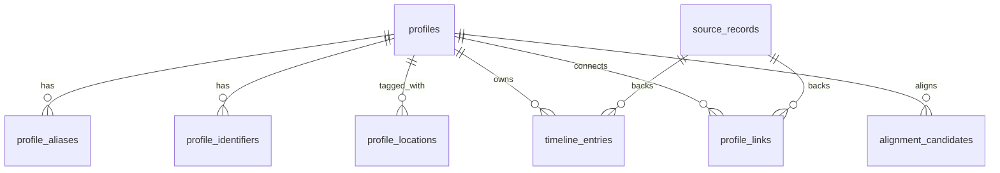

# Unified Entity Profiles & Cross-Source Alignment Design

## Purpose

The AI Research Tool collects data across many separate local corpora (`.data/entity-dossiers`, `.data/finra-rosters`, `.data/authority-timelines`, `.data/cdc-covid-timeline`, `.data/dod-covid-timeline`, `.data/wef-amnc`, `.data/physics-congress`, `.data/pqw-itmo`, `.data/meta25`, `.data/digitalearth-isde`, `.data/twdb-trinity-aquifer`, `.data/seismic`, `.data/tornadoes`, and `.data/knowledge/knowledge.sqlite` county deeds & research drive).

This layer introduces a **dedicated local SQLite profile & alignment database** (`.data/profiles/profiles.sqlite`, configurable via `RESEARCH_PROFILES_DIR`) using Node's built-in `node:sqlite` + FTS5 so all disparate sources converge onto canonical profiles, surface multi-angle perspectives, detect chronological timeline gaps, and propose reviewable cross-source alignments.

---

## Canonical Profile Ontology

### Main Actor Profiles
| `profile_type` | Description |
| --- | --- |
| `person` | Individuals: executives, FINRA/SEC brokers (CRD), scientists, speakers, officials, named parties |
| `firm` | Commercial firms, broker-dealers, corporations, banks, LLCs |
| `education` | Universities, colleges, schools, school districts (ISDs), academies, educational boards/systems |
| `nonprofit` | Non-profits, foundations, NGOs, scientific societies, museums, research institutes |
| `medical_hospital` | Medical hospitals, medical centers, clinics, health systems, behavioral/psychiatric facilities |
| `government` | Government globally: domestic federal/state/local agencies, military/defense, regulators, boards (e.g. CDC, DoD, DHS, ICE, DEA, FBI, USGS, NOAA, TWDB, White House), plus foreign national ministries, embassies, municipal governments, and intergovernmental/international bodies |

### Events & Timeline Container Profiles
| `profile_type` | Description |
| --- | --- |
| `historic_event` | Dated historical events, incidents, conflicts, directives, conferences, disasters, and overarching timeline topics where multiple sources converge (e.g. *COVID-19 Pandemic Response & Timelines*, *Timeline of Conflict Since 1914 (IWM)*, *Authority Initiatives & OK–TX Corridor Operations*) |

### Normalized Locations
Geographic locations are stored in `profile_locations` and on `timeline_entries.geo_key` using deterministic keys (e.g. `us:ok:county:bryan`, `us:tx:city:dallas`, `country:kazakhstan`) to enable geo-temporal alignment across corpora.

---

## SQLite Schema (`.data/profiles/profiles.sqlite`)

- **`profiles`** — canonical node (`id`, `slug`, `profile_type`, `name`, `normalized_name`, `status`, `summary`, `start_date`, `end_date`, `metadata_json`) + `profiles_fts` FTS5 index.
- **`profile_aliases`** — alternative names, acronyms, former names, CRDs, tickers.
- **`profile_identifiers`** — external exact IDs (`finra_crd`, `sec_cik`, `ticker`, `irs_ein`, `usgs_event`, `spc_om`, `dossier_slug`, etc.).
- **`profile_locations`** — structured locations (`raw`, `city`, `county`, `state`, `country`, `geo_key`, `role`).
- **`source_records`** — provenance pointers (`corpus`, `source_ref`, `source_url`, `title`, `published_date`, `excerpt`) pointing back to `.data/*` files or `knowledge:doc:<uuid>`.
- **`timeline_entries`** — dated observations with explicit **`angle`** (`civilian_health`, `defense_dod`, `law_enforcement`, `regulatory_finra`, `land_records`, `academic_research`, `geophysical`, `corporate`, `policy`, `financial`, `general`) + `timeline_entries_fts` FTS5 index.
- **`profile_links`** — typed, evidence-backed edges (`employed_by`, `registered_at`, `alumni_or_faculty`, `affiliated_with`, `participated_in`, `authored_or_spoke`, `part_of_subject`, `mentioned_in`, `regulator_of`, `family_or_associate`, `business_tie`, etc.).
- **`alignment_candidates`** — scored cross-source leads (`shared_identifier`, `same_entity_alias`, `cross_source_mention`, `shared_affiliation`, `co_occurrence_time_geo`, `angle_comparison`, `county_filing_match`, `timeline_gap_bridge`) carrying caution tiers (`observation` | `closer_look` | `stronger_indicator`) and user triage status (`proposed` | `confirmed` | `dismissed`).

---

## Timeline Gap Detection & Multi-Angle Alignment

`getProfileTimeline()` merges direct timeline entries with linked `historic_event` / child entries, computes breakdowns by `angle` and `source_corpus`, identifies multi-angle overlapping months, and scans for chronological gaps (`>= minGapDays`). For each detected gap, it automatically queries:
1. Other `timeline_entries` sharing normalized `geo_key` during the gap window.
2. Activity of linked actor profiles during the gap window.
3. Cross-corpus FTS5 keyword hits in `timeline_entries_fts`.
4. Read-only FTS5 queries against `.data/knowledge/knowledge.sqlite` (`chunks_fts`) for dated records falling inside the gap window.

---

## CLI, API, Agent Tools, & UI

- **CLI**:
  - `pnpm profiles:backfill` — idempotent backfill of all structured `.data/*` corpora + alignment pass + read-only `knowledge.sqlite` FTS cross-matching.
  - `pnpm profiles:align` — recompute alignment candidates only.
- **REST API** (localhost-only via `rejectUnlessLocalKnowledge`):
  - `GET/POST /api/profiles`
  - `GET/PATCH/DELETE /api/profiles/[id]`
  - `GET/POST /api/profiles/[id]/timeline`
  - `POST /api/profiles/links`
  - `GET/PATCH /api/profiles/alignments`
  - `POST /api/profiles/sync`
- **Agent Tools** (`src/lib/research/tools.ts`):
  - `search_profiles`
  - `get_profile_timeline`
  - `find_profile_alignments`
- **UI**: `/profiles` (`src/app/profiles/page.tsx`, `src/components/ProfilesClient.tsx`), linked from the main header.
